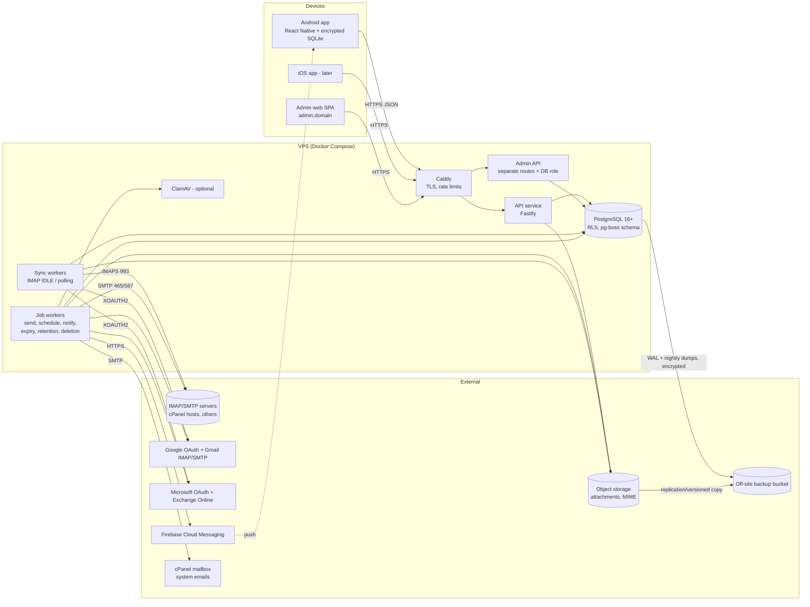

# 2. Architecture and Technology Stack

## 2.1 Stack (with reasons)

Every package named here exists today; versions are pinned at Milestone 1 after checking current releases and changelogs.

| Layer | Choice | Why / alternatives considered |
|---|---|---|
| Language | **TypeScript** end to end | Shared types and validation schemas between mobile, admin web and backend |
| Monorepo | **pnpm workspaces** (`apps/mobile`, `apps/admin-web`, `apps/backend`, `packages/shared`) | One repo, shared `zod` schemas and API types; no forced mobile code in the backend |
| Mobile | **React Native via Expo (development builds, not Expo Go)**, Android first, iOS-ready | Expo gives EAS Build, config plugins, OTA updates; native modules still possible |
| Mobile local DB | **SQLite with SQLCipher encryption** (`op-sqlite` with SQLCipher, or `expo-sqlite` with its SQLCipher option — confirmed at M7) | Offline cache must be encrypted at rest |
| Mobile secrets | **`expo-secure-store`** (Android Keystore / iOS Keychain) | Refresh token + local DB key |
| Mobile rich-text editor | **10tap-editor** (`@10play/tentap-editor`, Tiptap/ProseMirror in a WebView) | Mature RN rich text; output HTML is post-processed for email compatibility |
| Message rendering | Sandboxed **`react-native-webview`** (JS disabled, remote content blocked by default, navigation intercepted) | Email HTML is hostile input |
| Admin web | **React + Vite** SPA, served at `admin.<domain>` | Separate surface, separate cookies, strict CSP |
| User web client | **Not in v1; architecture allows it** (same API; could be added with React or `react-native-web`) | Halves the UI surface for v1. Recommended as a post-launch milestone if users ask |
| Backend runtime | **Node.js 22 LTS + Fastify** | Fast, schema-validated routes; best-in-class mail libraries are in Node |
| IMAP | **ImapFlow** | Modern IMAP client: IDLE, CONDSTORE/QRESYNC, XOAUTH2, MOVE, special-use |
| SMTP | **Nodemailer** | De-facto standard; XOAUTH2; builds MIME |
| MIME parsing | **mailparser** (streaming) | Same ecosystem; handles encodings/attachments |
| HTML sanitising | **sanitize-html** (server side) | Allow-list based; strips scripts/forms/event handlers |
| DB access | **Kysely** (typed SQL query builder) + plain **SQL migration files** run by a small migrator | Keeps SQL explicit (needed for RLS/`SET LOCAL`), typed results |
| Job queue / scheduler | **pg-boss** (PostgreSQL-backed) | Durable jobs, retries, backoff, cron, singleton keys — no Redis to operate |
| Password hashing | **argon2id** via `argon2` | OWASP-recommended |
| Crypto | Node `crypto` AES-256-GCM, envelope encryption | No home-grown crypto primitives |
| Push | **Firebase Cloud Messaging** via `firebase-admin` (Android; iOS through APNs-in-FCM later) | Standard for Android |
| Object storage | S3 API via `@aws-sdk/client-s3` → Backblaze B2 / Cloudflare R2 / Wasabi / MinIO | Portable |
| Malware scanning | **ClamAV** (`clamd`) container, optional | Free, self-hosted; signatures miss plenty — shown as such |
| Reverse proxy / TLS | **Caddy** (automatic Let's Encrypt) | Simple, secure defaults |
| Observability | Structured logs (`pino`) with redaction, `/metrics` (Prometheus format), Uptime Kuma or a hosted uptime check | Small footprint |
| Container runtime | Docker Compose on the VPS | Reproducible, portable |

## 2.2 Component diagram



## 2.3 What runs where

| Mobile device | Backend (VPS) | PostgreSQL | Object storage |
|---|---|---|---|
| UI, navigation, composer | Auth, sessions, RBAC | Users, sessions, devices, access periods | Attachment bytes (encrypted with per-user key) |
| Encrypted SQLite cache of recent threads/bodies | All IMAP/SMTP/OAuth traffic — **the device never talks to mail servers** | Mailboxes, server settings, **encrypted** credentials | Frozen outbound MIME |
| Local outbox for offline sends (with idempotency keys) | Sync engine, send pipeline, scheduler | Messages metadata, bodies (subject to retention), threads, flags | Signature/inline images |
| Draft autosave (local then server) | Push dispatch, reminders, expiry, retention, deletion | Drafts, outbound queue, attempts, reminders | — |
| Secure storage: refresh token, DB key | HTML sanitising, phishing heuristics, AV scanning | Search index (`tsvector`) | — |
| Receives FCM pushes | Backups | Audit log, events, job queue (`pgboss` schema) | — |

Mail credentials never leave the backend after entry; the app sends them once over TLS during connection setup and they cannot be read back through the API.

## 2.4 Account lifecycle and the calendar month

States: `pending` → (`approved` | `rejected`); `approved` → `suspended` (reason `expired` or `admin_action`) → `approved` (admin only); any → `deleting` → row removed.

- **Approval** (one transaction): set `status='approved'`, `approved_at=now()`, compute `access_expires_at`, insert `access_periods` row, write `audit_log`.
- **Calendar month rule:** `ends_at = ((starts_at AT TIME ZONE business_tz) + interval '1 month') AT TIME ZONE business_tz`, where `business_tz` is the admin-configured IANA zone (default `UTC`; set it to your own zone). PostgreSQL clamps to the end of month: approved 31 Jan 15:00 → expires 28 Feb 15:00 (29 Feb in leap years); approved 15 Mar → 15 Apr same local wall-clock time, even across a DST change. Verified on PostgreSQL 16 during design.
- **Boundary:** the period is half-open `[starts_at, ends_at)`. At `ends_at` exactly, access is denied.
- **Immediate enforcement:** every authenticated request checks `status='approved' AND access_expires_at > now()` (cached per request, not per session), so access ends on time even if the expiry job is late. The **expiry job** (every minute) flips expired users to `suspended/expired`, revokes refresh tokens, pauses sync and scheduled sends, and notifies user + admin. A reminder is sent to the user 3 days and 1 day before expiry.
- **Renewal/reactivation:** admin chooses "renew from now" (default — user was suspended, so the new month starts on reactivation) or "extend from previous expiry" (for renewals done *before* expiry). Each creates a new `access_periods` row with an optional payment note.
- **Suspension retains everything.** Sync pauses (`mailboxes.status='paused_account'`) to stop new storage and connections; it resumes on reactivation and catches up from checkpoints.
- **Scheduled sends during suspension (safe explicit policy):** at suspension every outbound message in `pending_undo`, `scheduled` or `queued` moves to `paused_suspended` (previous status saved). **Nothing in that state is ever sent automatically.** After reactivation the app shows a "Paused messages" screen listing each one with its original time; the user must choose *Send now*, *Reschedule* or *Discard* (bulk actions allowed). A message whose provider submission had already started before suspension is allowed to finish; its result is recorded.

## 2.5 Mailbox connection

1. User enters address + password (or taps "Sign in with Google/Microsoft").
2. **Discovery**, in order, stopping at the first that authenticates:
   1. Known provider by MX/domain (Gmail/Workspace, Microsoft 365/Outlook, Yahoo, iCloud, Zoho, Fastmail…) → OAuth or known endpoints.
   2. Thunderbird-style autoconfig: `https://autoconfig.<domain>/mail/config-v1.1.xml`, `https://<domain>/.well-known/autoconfig/mail/config-v1.1.xml`, then the Mozilla ISPDB.
   3. Microsoft Autodiscover (POX) for Exchange-like hosts.
   4. DNS SRV records (`_imaps._tcp`, `_submission._tcp`, RFC 6186).
   5. cPanel-aware guesses: `mail.<domain>`, then the MX host and the hostname in the presented TLS certificate (shared cPanel servers often present a cert for the *server* name like `server123.host.com`, not `mail.yourdomain`); ports 993/465/587.
3. **Test** IMAP login + `LIST`, and SMTP `EHLO`/`AUTH` (no message sent). Record capabilities (`IDLE`, `CONDSTORE`, `QRESYNC`, `MOVE`, `UIDPLUS`, `SPECIAL-USE`, `OBJECTID`, SMTP `SIZE`).
4. TLS certificates are always verified. On hostname mismatch the app offers the hostname that the certificate *is* valid for (usually works on cPanel). Pinning a non-matching certificate requires an explicit warning screen and stores the SPKI hash; we never offer "ignore certificate errors".
5. Save only after both tests pass (or the user explicitly saves a receive-only mailbox, labelled as such).
6. Failure → manual form (hosts, ports, TLS mode, auth method, usernames) with the specific error ("authentication rejected", "connection timed out on port 587", "certificate valid for X, not Y").

**Password changes / auth failures:** an `AUTH` failure (IMAP `NO [AUTHENTICATIONFAILED]`, SMTP 535) immediately sets `status='auth_failed'`, stops all retries for that mailbox, records a `mailbox_events` row, and notifies the user once ("Mailbox sales@… needs its password updated"). The admin sees it in mailbox health. The user enters the new password → re-test → `generation` incremented → sync resumes from checkpoints. Repeated auth attempts with a bad password could lock the real mailbox (cPanel cPHulk/fail2ban), which is why we never retry them.

**Transient failures** (DNS, timeouts, 4xx, connection resets): exponential backoff with jitter, 30 s → 1 m → 2 m → … capped at 30 min, `next_retry_at` stored. After 6 hours of continuous failure the user and admin are notified; retries continue at the cap.

**Google:** Gmail IMAP/SMTP with OAuth requires the `https://mail.google.com/` scope, which Google classifies as **restricted**. Production use beyond test users requires Google OAuth app verification **and an annual third-party security assessment (CASA)**, which costs money and time. In OAuth "testing" mode refresh tokens expire after 7 days and only listed test users can connect. **Interim:** Gmail/Workspace mailboxes via **app passwords** (requires 2-Step Verification; Workspace admins can disable it). Decision needed from you: see `08-risks-and-decisions.md`.

**Microsoft 365 / Outlook.com:** basic authentication for IMAP has been turned off in Exchange Online and Microsoft is retiring basic auth for SMTP AUTH, so OAuth (`IMAP.AccessAsUser.All`, `SMTP.Send`, `offline_access`) is required. Needs an Entra ID app registration (free) and, for other organisations' tenants, admin consent and publisher verification. Some tenants disable SMTP AUTH entirely; then sending must go through Microsoft Graph `sendMail` (planned fallback).

## 2.6 Sync engine

- **Per mailbox, one long-lived IMAP connection** in `IDLE` on INBOX (IDLE watches only the selected folder). Other folders are polled: Sent/Drafts/Junk every 5 min, others every 15 min, plus on-demand when the user opens them. Without `IDLE`, INBOX is polled every 2 min. IDLE is re-issued every 25 min (servers drop it after ~30).
- **Checkpoints per folder:** `UIDVALIDITY`, `UIDNEXT`, `HIGHESTMODSEQ`. With `CONDSTORE/QRESYNC` we fetch only changed flags and `VANISHED` UIDs; without them we diff UID lists in batches and re-read flags for the recent window. If `UIDVALIDITY` changes, the folder is resynced and messages are re-matched by `Message-ID` + date + size to avoid duplicates.
- **Dedup:** `UNIQUE (mailbox_id, provider_key)` where `provider_key` is Gmail `X-GM-MSGID`, RFC 8474 `EMAILID`, or for plain IMAP a key from the first folder/UID it was seen in. Every insert is `INSERT … ON CONFLICT DO NOTHING/UPDATE`, so job retries are safe.
- **Initial sync:** last 90 days (configurable) of headers + bodies, newest first, so the inbox is usable within seconds; older mail is fetched on demand (headers first). No notifications during initial sync.
- **Two kinds of truth:** each message stores `server_state` (`present`, `deleted_on_server`, `unknown`) and the UI badges messages that exist only on the platform. User actions (read, flag, move, delete, spam) are written to `mailbox_operations` and shown as *pending* until the server confirms; failures revert the UI state and show an error. We never mark something "done" on the server before it is.
- **Delete/archive semantics:** Delete = move to the provider Trash (if it exists) else `\Deleted` + `UID EXPUNGE` (requires confirmation). Archive = move to the `\Archive` special-use folder; for providers without one, the user chooses a folder once.
- **Sent sync:** after a successful send, `IMAP APPEND` the exact MIME to the Sent folder, unless the provider saves sent mail itself (Gmail, Microsoft 365 via SMTP) — then we pick it up on the next Sent poll and match it by Message-ID.
- **Provider push (later):** Gmail API `watch` (Pub/Sub) and Microsoft Graph change notifications can replace IDLE for those providers; out of scope until OAuth is approved.
- **Scale:** ~100 IDLE connections for 20 users is light (≈ a few MB RAM each). Workers shard mailboxes with advisory locks so exactly one worker owns a mailbox; ownership lease is renewed every 30 s and taken over if a worker dies. cPanel Dovecot allows ~20 connections per user per IP by default; we use 1–2.
- **Stale-job safety:** every job carries `(user_id, mailbox_id, generation)`; the worker re-reads them in its transaction and aborts if the user is not `approved`, the mailbox is gone/paused, or the generation changed. Composite FKs reject inserts for deleted parents, so a stale job cannot recreate data.

## 2.7 Threading

1. Provider thread id if available (Gmail `X-GM-THRID`).
2. Otherwise header threading (JWZ-style): `References` and `In-Reply-To` chains matched against `Message-ID` within the **same user**.
3. Subject is used only as a tiebreaker for a message whose `In-Reply-To` points to a message we don't have, *and* that shares a participant and normalised subject within 14 days. Subject similarity alone never merges threads.

Threads are per user and may span mailboxes (e.g. you CC'd `support@` on a `sales@` thread). Every message is labelled with its mailbox; the per-mailbox inbox shows a thread if it contains at least one message from that mailbox, and expands only that mailbox's messages by default. **Reply defaults to the mailbox that received the message being replied to**; if the original was sent *from* one of your mailboxes, reply uses that one. Changing the sender is explicit and highlighted.

## 2.8 Send pipeline (undo, retries, no duplicates)

```
Send pressed ──► device creates idempotency_key (UUID) ──► POST /outbound
   │                                          │
   │ offline? keep in local outbox,           ▼
   │ undo happens locally, upload later   status = pending_undo, release_at = now + 10 s
   ▼                                          │  (Undo → atomic UPDATE … WHERE status='pending_undo')
                                              ▼
                     status = queued (or scheduled until scheduled_at)
                                              │ worker claims with lease (FOR UPDATE SKIP LOCKED)
                                              ▼
                     status = sending, delivery_attempts row inserted, then SMTP/API submit
                          │                     │                       │
                    250 accepted           4xx / timeout            5xx permanent
                          ▼                before DATA                   ▼
                    status = sent,         retry with backoff      status = failed,
                    APPEND to Sent         (max 5, ≤ 2 h)          user notified
                          │
              crash/timeout AFTER the message body was transmitted but before 250 seen
                          ▼
                    status = uncertain → never auto-retried; we look for the Message-ID
                    in the Sent folder; otherwise the user decides "send again" or "discard"
```

- MIME is built once and frozen in object storage with a fixed `Message-ID` before the first attempt, so any resend is byte-identical and detectable.
- `UNIQUE (user_id, idempotency_key)` makes repeated POSTs from flaky networks harmless.
- "Sent" is shown only after the provider accepts (`250` after DATA, or API 2xx). The UI wording is "Sent to your mail server", not "Delivered"; recall after acceptance is not offered.
- Rate/recipient limits per mailbox (`send_limit_per_hour`, `max_recipients_per_msg`, default conservative values for cPanel hosts which commonly cap at a few hundred per hour) are enforced before claiming; messages wait rather than fail.
- **Scheduled sends:** stored as UTC `scheduled_at` + the IANA zone the user picked. Editing a scheduled message converts back to a draft until rescheduled. DST: a local time that doesn't exist (spring-forward gap) is rejected in the picker; an ambiguous one (fall-back) uses the first occurrence and says so.

## 2.9 Composer, signatures, templates

- 10tap-editor produces HTML; the backend normalises it into email-safe HTML (inline styles, no `<style>` dependence beyond basics, tables avoided except signatures, `` with `cid:` for inline images) and generates a `text/plain` alternative. Output is tested against Gmail, Outlook (desktop + web) and Apple Mail in M6; differences are documented rather than promised away.
- Signatures: many per user; one default per mailbox; inserted once inside a marked block so switching sender swaps the signature instead of adding another. Logos as inline `cid:` images (not remote URLs, which many clients block).
- Templates and quick replies are per user; insert-only (no mail merge).
- Autosave: local every 2 s while typing, server every 10 s/on blur; `drafts.version` gives optimistic concurrency.
- Recipient validation: syntax (RFC 5322 addr-spec), duplicate detection, warning for > N visible recipients (suggest BCC), confirmation for "Reply all" with > 10 recipients and for sending without a subject.

## 2.10 Attachments

- Metadata on sync; bytes fetched on first open (or eagerly for messages < 5 MB if quota allows) and stored in object storage, encrypted with the user's key, deduplicated per user by SHA-256.
- Upload: streamed to the backend, size checked against the **sender mailbox's** advertised SMTP `SIZE` (accounting for ~37% base64 overhead) and shown to the user before sending. Infrastructure cap: 50 MB per upload request, documented, because most providers reject messages above 25–35 MB anyway; raised if your providers allow more.
- Validation: magic-byte sniffing (`file-type`), filename sanitised for display and never used as a path, executables/scripts (`.exe .scr .js .vbs .bat .cmd .ps1 .jar .msi .apk`, macro Office docs) flagged "dangerous"; download of dangerous types requires an extra confirmation; files are never executed or rendered by the server.
- Preview: images and PDFs rendered client-side; Office files opened via the OS share sheet (no server conversion in v1).

## 2.11 Search

- PostgreSQL full-text search: `messages.search_vector` (subject weight A, from/to B, body C, attachment filenames D) with a `GIN` index; `pg_trgm` for partial address/subject matches; B-tree indexes for date/mailbox/flags. Always filtered by `user_id` (and RLS enforces it).
- Filters: sender, recipient, subject, date range, mailbox, read/unread, flagged, has attachment, folder (including Sent). Saved searches store the structured filter JSON.
- **Limitations:** searches platform-stored copies only. Messages outside the sync window or with evicted bodies match on headers only; a "Search on server" button runs IMAP `SEARCH` against one mailbox for older mail. Language stemming uses the `simple` config by default (works for any language, no stemming); configurable.
- **Storage implications:** the index is roughly 20–40% of stored body text size. It is not counted in user quota (documented) but monitored system-wide.

## 2.12 Spam and blocking

- Provider spam filtering is primary. "Mark as spam" moves to the provider Junk folder (and sets `$Junk` keyword where supported); "Not spam" moves back to INBOX.
- Platform blocklist (address or domain, per user, optionally per mailbox): matching messages are hidden from the inbox into a "Blocked (platform)" view. The UI explicitly says: *"Blocked here only. Messages still reach your mail server."* Server-side rules (e.g. cPanel filters, Sieve) are a possible later enhancement and only claimed when actually configured.

## 2.13 Bulk email

Supported: one message to many recipients, or "send individually" (one copy per recipient, same content, rate-limited). Safeguards: warning when > 10 addresses are visible in To/CC ("Recipients can see each other — move to BCC?"), per-mailbox hourly limits, total recipients per message capped by provider limit, duplicate-send protection as above, the sender mailbox shown prominently in a confirmation sheet. Not provided: list imports, tracking pixels, unsubscribe management, bypassing provider limits. For newsletters/marketing, use a dedicated service (Mailchimp, Brevo, Amazon SES, Postmark Broadcast) that handles consent, unsubscribe (RFC 8058), bounce processing and sender reputation — sending marketing through business mailboxes risks getting your domains blacklisted.

## 2.14 Notifications

- New message detected (not during initial/backfill sync, not platform-blocked, not in Junk) → `notification_outbox` row per active device, `dedupe_key = new_mail:<message_id>`, inserted in the same transaction as the message, so each message produces at most one push per device even if the sync job reruns.
- Text: **"New email received at sales@company.com"** — no sender, no subject. FCM data payload carries only IDs; the app fetches content after unlocking.
- Bursts: more than 5 messages to one mailbox within 60 s are collapsed into "5 new emails received at sales@…" (Android notification grouping per mailbox); every email still counts. Opening a message on one device clears its notification on others (silent push).
- FCM `UNREGISTERED`/`INVALID_ARGUMENT` → device token removed. Logout/revoked session → device push disabled immediately.
- Other notification kinds: send failed, mailbox needs password, reminder due, quota warning, account expiring/expired.

## 2.15 Offline operation and multi-device sync

- Device keeps an encrypted SQLite cache of the latest N threads per mailbox (default 500) plus anything opened.
- Pull: `GET /sync?cursor=<seq>` returns `change_feed` entries since the cursor (messages, threads, flags, drafts, outbound status, reminders). Push: FCM silent message "changes available" when the app is in background.
- Offline writes go to a local **op queue** with client-generated `client_op_id`s (flags, moves, drafts, sends). On reconnect they replay in order; server dedupes by id.
- **Conflict policy:**
  - Flags/read state: last-writer-wins per field by server receive time; the provider's state is final truth when the server sync disagrees.
  - Move/delete: first to reach the provider wins; a later conflicting op becomes `superseded` and the user is told ("Message was already moved to Trash on another device").
  - Drafts: optimistic version check. On conflict both versions are kept ("Draft (conflict copy from Pixel 8)"); never silently overwritten.
  - Sends: idempotency key ⇒ at most one send; an offline-queued send shows "Waiting for connection", never "Sent".

## 2.16 Storage, quota and retention

- Quota counts: stored body text + sanitised HTML, unique attachment bytes (after per-user dedup), draft content + uploads, frozen outbound MIME. Not counted: database indexes, search index, metadata rows, backups (all documented in the user's storage screen).
- Default 5 GB (admin-adjustable per user). Warnings at 80% and 95% (push + banner); admin is notified at 100%.
- Retention (defaults: bodies 365 days, attachments 180 days, flagged mail kept): nightly job evicts eligible bodies/attachments (oldest first, non-flagged first) → `body_state='evicted'`; the message stays visible and re-fetchable from the server while it exists there.
- At 100% after eviction: `storing_paused=true` — new mail still syncs **headers and notifications**, bodies/attachments are fetched live from the server when opened but not stored. **Nothing is ever deleted from the original provider because of quota.**

## 2.17 Mailbox disconnect and deletion

- **Disconnect & keep data:** credentials deleted, sync stopped, `status='disconnected'`, messages remain searchable/readable, labelled "Disconnected — read-only". Reconnecting the same address re-links by `provider_key`/Message-ID.
- **Disconnect & delete data:** confirmation shows the exact address and counts ("This removes 12,430 stored emails, 3.2 GB of attachments, 4 drafts and 2 scheduled messages for sales@company-a.com from this platform. Your mailbox on the mail server is not affected.") User types the address to confirm. A `deletion_requests` row drives a batched purge (cascades via FKs + object deletes). Other mailboxes are untouched — enforced by composite FKs and tested.
- **Permanent user deletion (admin):** two-step confirm (type user email + admin TOTP). Sets `status='deleting'`, revokes sessions and device tokens, cancels jobs, deletes the user's DEK (crypto-shreds object storage, including versioned copies), then batched cascade delete. An `audit_log` entry without personal data remains. Deleted user IDs are appended to an off-site **deletion ledger** that the restore procedure replays (see `06`).

## 2.18 Background jobs

All jobs run in `pg-boss`. Idempotent by design (unique keys, `ON CONFLICT`, state-machine `UPDATE … WHERE status = expected`).

| Job | Trigger | Retry / backoff | Notes |
|---|---|---|---|
| `mailbox.sync` (IDLE loop) | Long-running per mailbox, leased | Reconnect backoff 30 s→30 min; auth errors stop | One owner per mailbox |
| `folder.poll` | Every 2–15 min per folder | 3 tries, then next cycle | |
| `message.fetch-body` / `attachment.fetch` | On new mail / on demand | 5 tries, exp. backoff | Respects quota |
| `outbound.release` | At `release_at` / `scheduled_at` | — | Moves to `queued` |
| `outbound.send` | Queued | 5 temp-failure tries over ≤ 2 h; never on permanent/uncertain | Lease + attempt rows |
| `outbound.append-sent` | After send | 5 tries; failure shown, not fatal | |
| `mailbox.operation` | User action | 5 tries; then `failed` + UI revert | |
| `notify.push` | Outbox rows | 3 tries; drop on invalid token | |
| `reminder.fire` | Every minute | 3 tries | |
| `account.expiry` | Every minute | idempotent | Suspends, pauses, notifies |
| `account.expiry-warning` | Hourly | dedupe by user+period | 3 days / 1 day |
| `mailbox.health` | Every 15 min | — | Admin alerts |
| `storage.recalc` / `storage.retention` | Nightly + on threshold | idempotent | |
| `deletion.run` | On request | resumable batches | |
| `blob.gc` | Daily | grace period 7 days | |
| `backup.*` | Nightly + continuous WAL | alert on failure | Runs outside app container |
| `maintenance.prune` | Daily | — | login_attempts 90 d, change_feed 30 d, done jobs 7 d |

Monitoring: dashboard (admin) shows queue depths, failed jobs, oldest pending job age, mailboxes in error, last successful backup. Alerts by email to the admin address when thresholds are crossed.
